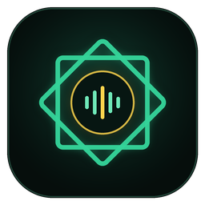

<div align="center" dir="rtl">



# مَثَانِي — Mathani

### مشغل القرآن الكريم الاحترافي لسطح مكتب ويندوز مع الجزيرة التفاعلية (Dynamic Island)

[](https://github.com/msayed-io/mathani-player/actions/workflows/build.yml)
[](https://github.com/msayed-io/mathani-player/releases/latest)
[](LICENSE)

[**تحميل المثبّت المباشر لويندوز (`Mathani-Setup.exe`)**](https://github.com/msayed-io/mathani-player/releases/latest/download/Mathani-Setup.exe)

</div>

---

<div dir="rtl">

## نبذة عن «مَثَانِي»

**مَثَانِي (Mathani)** هو تطبيق سطح مكتب أصيل لنظام **Windows 10 / 11** مبني بتقنية **Tauri v2 (Rust + React 19)**، صُمِّم خصيصاً لتشغيل وتنظيم ملفات ومجلدات التلاوات القرآنية المحلية على حاسوبك بهوية بصرية زجاجية هادئة تحفظ وقار القرآن الكريم، مع دمج كامل ودقيق لـ **الجزيرة التفاعلية العلوية (Dynamic Island)** في أعلى الشاشة دون أي مساس بشريط مهام ويندوز الأصلي.

### أبرز المزايا

- **الجزيرة التفاعلية الأصلية في أعلى الشاشة (Dynamic Island):**
  - متكاملة لحظياً وباتصال محلي فائق الدقة (`< 1ms IPC`) مع مشغل مثاني: تعرض اسم السورة، اسم القارئ، لوحة السورة الزخرفية، شريط التقدم التفاعلي، وموجات التردد الصوتي الحية (**WASAPI Loopback FFT**).
  - تحكم كامل من الجزيرة (تشغيل/إيقاف مؤقت، السورة التالية/السابقة، التقديم والتأخير، والضغط على اسم السورة لفتح نافذة المشغل فوراً).
  - تحترم شريط مهام ويندوز الأصلي 100% ولا تقوم بإخفائه أو تعديله مطلقاً، وتختفي تلقائياً عند تشغيل التطبيقات بملء الشاشة.
- **مكتبة قرآنية ذكية للملفات والمجلدات المحلية (100% بدون إنترنت):**
  - استيراد مجلدات كاملة أو ملفات صوتية مفردة عبر مستعرض الملفات أو **السحب والإفلات المباشر (Drag & Drop)**، مع كشف تلقائي لمجلدات القرآن على الجهاز.
  - تعرّف ذكي على **جميع سور القرآن الكريم الـ 114** (سواء كانت الملفات مرقمة `001.mp3` أو مسماة بالعربية أو الإنجليزية أو عبر وسوم ID3v2 بما فيها الترميز العربي الكلاسيكي `Windows-1256`)، مع بيانات السورة (مكية/مدنية، عدد الآيات، الجزء).
  - تصنيف تلقائي حسب **القراء** مع لوحات زخرفية إسلامية (ربع الحزب ۞) مولَّدة محلياً لكل سورة أو استخراج الغلاف المدمج داخل الملف.
- **أدوات الحفظ والمراجعة والتدبر:**
  - **تكرار المقطع للحفظ (A–B Repeat):** تحديد نقطة البداية `أ` ونقطة النهاية `ب` لتكرار الآيات بدقة عالية.
  - **العلامات المرجعية للآيات والمواضع:** حفظ المواضع المهمة مع ملاحظات نصية والعودة إليها بضغطة واحدة.
  - **متابعة الختمة والاستماع:** تمييز السور المكتملة وحفظ آخر موضع توقفت عنده تلقائياً.
  - **مؤقت السكينة (النوم)** والتحكم في **سرعة التلاوة** (`0.75x` إلى `1.5x`) واختصارات لوحة المفاتيح.

## البناء من المصدر (Build from Source)

المتطلبات: **Node.js 22+** و **Rust Stable** على نظام Windows 10/11:

```bash
npm ci
npx tauri build --bundles nsis
```

ينتج ملف التثبيت المباشر في المسار:
`src-tauri/target/release/bundle/nsis/Mathani_1.0.0_x64-setup.exe`

## الترخيص والشكر

مرخّص بموجب رخصة [GNU General Public License v3.0](LICENSE).
محرك الجزيرة التفاعلية العلوية والهوية الزجاجية مبني على مشروع [Bloom](https://github.com/SehajveerSingh2005/bloom) المفتوح المصدر مع تكييفه الكامل لتجربة الاستماع القرآني في «مَثَانِي».

</div>
